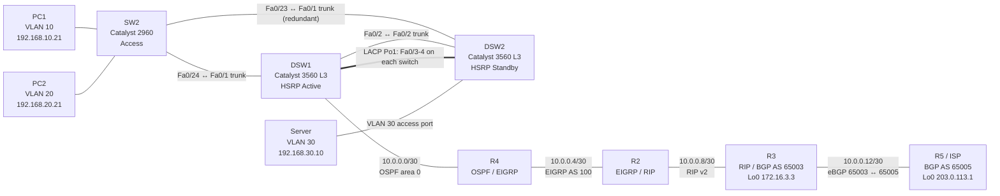

Built as part of  [https://github.com/windowpc590/Network-lab-writeups/blob/main/README.md#pingmynetwork-sandbox-challenge](https://pingmynetwork.com/event/sandbox-challenge)
# Enterprise Network Lab — PMN-OS 3.0

A multi-protocol enterprise network lab built and validated in **PingMyNetwork (PMN-OS 3.0)**. The project demonstrates VLAN segmentation, first-hop redundancy, Layer 2 redundancy, dynamic routing, route redistribution, and end-to-end reachability between an enterprise server network and an ISP-side loopback.

> **Configuration accuracy note:** This repository package was prepared from the lab details and command outputs recorded during troubleshooting. It is not a complete, verbatim export of every device configuration. Files under `configurations/` contain only reconstructed snippets or export guidance. Replace/add them with the exact saved configurations exported from PMN-OS before treating them as authoritative.

## Lab objectives

- Segment the campus LAN using VLANs 10, 20, 30, and 99.
- Provide redundant default gateways using HSRP.
- Provide redundant Layer 2 paths and an LACP EtherChannel between distribution switches.
- Route between the enterprise LAN and WAN using OSPF, EIGRP, RIP v2, and eBGP.
- Demonstrate route redistribution between routing domains.
- Verify end-to-end reachability to router loopbacks and the server subnet.

## Topology

## Device and addressing inventory

| Device | Interface / role | Address |
|---|---|---|
| R4 | Gi0/0 ↔ DSW1 Gi0/1 | 10.0.0.1/30 |
| DSW1 | Gi0/1 ↔ R4 Gi0/0 | 10.0.0.2/30 |
| R4 | Gi0/1 ↔ R2 Gi0/0 | 10.0.0.5/30 |
| R2 | Gi0/0 ↔ R4 Gi0/1 | 10.0.0.6/30 |
| R2 | Gi0/1 ↔ R3 Gi0/0 | 10.0.0.9/30 |
| R3 | Gi0/0 ↔ R2 Gi0/1 | 10.0.0.10/30 |
| R3 | Gi0/1 ↔ R5 Gi0/0 | 10.0.0.13/30 |
| R5 / ISP | Gi0/0 ↔ R3 Gi0/1 | 10.0.0.14/30 |
| R2 | Loopback0 | 172.16.2.2/32 |
| R3 | Loopback0 | 172.16.3.3/32 |
| R5 / ISP | Loopback0 | 203.0.113.1/32 |
| Server | VLAN 30 | 192.168.30.10/24, GW 192.168.30.1 |

### VLAN and gateway plan

| VLAN | Name / purpose | Subnet | HSRP virtual IP | DSW1 SVI | DSW2 SVI |
|---|---|---|---|---|---|
| 10 | USERS | 192.168.10.0/24 | 192.168.10.1 | 192.168.10.2 | 192.168.10.3 |
| 20 | ADMIN | 192.168.20.0/24 | 192.168.20.1 | 192.168.20.2 | 192.168.20.3 |
| 30 | SERVERS | 192.168.30.0/24 | 192.168.30.1 | 192.168.30.2 | 192.168.30.3 |
| 99 | MANAGEMENT | 192.168.99.0/24 | 192.168.99.1 | 192.168.99.2 | 192.168.99.3 |

SW2 management SVI: `192.168.99.10/24`, default gateway `192.168.99.1`.

## Routing design

| Segment / device | Protocol | Key details |
|---|---|---|
| DSW1 ↔ R4 | OSPF process 1, area 0 | DSW1 router ID 1.1.1.1; R4 router ID 4.4.4.4 |
| R4 ↔ R2 | EIGRP AS 100 | Link subnet 10.0.0.4/30 |
| R2 ↔ R3 | RIP v2 | Link subnet 10.0.0.8/30; loopback reachability |
| R3 ↔ R5 | eBGP | R3 AS 65003; R5 AS 65005; neighbor addresses 10.0.0.14 and 10.0.0.13 |
| R4 | Redistribution | OSPF ↔ EIGRP configured during lab; verify route tags/policies before production use |
| R2 | Redistribution | RIP-to-EIGRP configured to propagate R3 loopback and ISP loopback routes |
| R3 | Redistribution/origination | BGP-to-RIP configured; `192.168.30.0/24` advertised to R5 through BGP |

## Verification results recorded

The following checks were observed during the lab session:

- Server `192.168.30.10` reached VLAN 30 gateway `192.168.30.1` and DSW1/DSW2 SVIs.
- Server could reach `172.16.2.2` (R2 loopback).
- R4 ping to `172.16.3.3` succeeded: 5/5 replies.
- Server ping to `172.16.3.3` succeeded: 4/4 replies, 0% loss.
- Server ping to `203.0.113.1` initially failed while the ISP lacked a route back to `192.168.30.0/24`.
- R5 BGP table later showed `192.168.30.0/24` via `10.0.0.13` and the user confirmed server ping to `203.0.113.1` succeeded: 4/4 replies, 0% loss.
- R4 learned `203.0.113.1/32` as an EIGRP external route via `10.0.0.6`.

The ISP-side destination `203.0.113.1` is a loopback in this lab, not a real Internet endpoint. These tests demonstrate lab routing only.

## Repository layout

- `topology/topology.md` — topology and interface map.
- `documentation/routing-and-design.md` — protocol design and redistribution notes.
- `verification/test-results.md` — observed validation evidence and retest checklist.
- `configurations/README.md` — instructions for adding exact PMN-OS exports.
- `configurations/reconstructed-snippets/` — known snippets reconstructed from the troubleshooting session; not full device backups.
- `docs/PUBLISHING.md` — safe publishing and Git instructions.

## How to use

1. Recreate the topology in PMN-OS 3.0 or adapt it to a compatible network simulator.
2. Export each device's saved configuration from PMN-OS.
3. Review and sanitize all configuration files before committing.
4. Compare the actual export against the reconstructed snippets; don't paste snippets blindly into a running device.
5. Follow `docs/PUBLISHING.md` to publish the project.

## Security and scope

This is a learning/portfolio lab. Before publishing, remove credentials, shared secrets, private keys, tokens, customer details, and any non-public company information. Do not include real production configurations without explicit authorization.

## License

The accompanying original documentation is provided under the MIT License. Simulator assets, vendor configuration syntax, trademarks, and third-party files remain subject to their own terms. See `LICENSE`.
